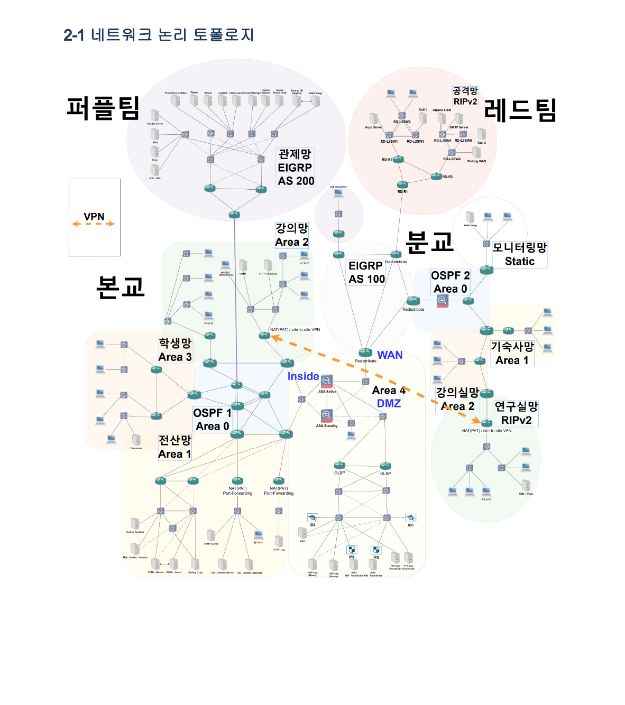
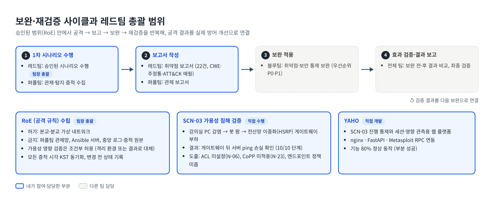
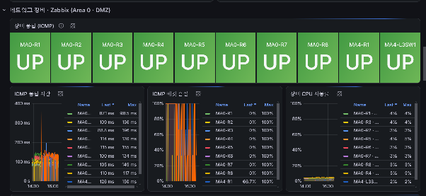
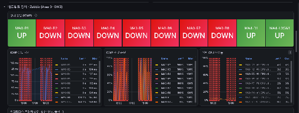
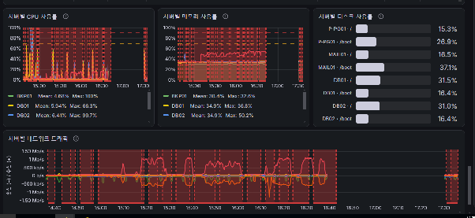

# 대학 IT 인프라 보안 진단 — 레드팀 총괄 & 가용성 침해 시나리오 검증

> 대학 IT 인프라(본교·분교·연구망)를 대상으로 한 모의해킹 프로젝트에서 **레드팀 팀장**을 맡아 공격 범위와 규칙(RoE)을 정하고, 블루·퍼플팀과 "공격 → 보고 → 보완 → 재검증" 절차를 운영했습니다. 직접 맡은 가용성(DDoS) 시나리오에서는 내부 PC 감염이 전산망 이중화 게이트웨이 뒤 서비스까지 영향을 줄 수 있음을 확인하고, ACL·CoPP 미적용 등 네트워크 보완 과제를 도출했습니다.

> 모든 공격은 교육 과정의 격리된 가상 실습 환경에서, 승인된 범위(RoE) 안에서만 수행했습니다. 공격 도구·페이로드 코드는 공개하지 않습니다.

📄 [프로젝트 전체 결과보고서 (Google Docs)](https://docs.google.com/document/d/1by0t-3ZAO7lP5uoPrewn-vIXnjpeGiVCPoxAXCsHy0Y/edit?tab=t.0)

| 항목 | 내용 |
|---|---|
| 기간 | 2026.09.21 ~ 2026.10.07 |
| 인원 | 블루·레드·퍼플팀 + 인프라 담당 — 국비교육 정보보안 전문가 과정 3차 프로젝트 |
| 내 역할 | **레드팀 팀장(5인)** — RoE 수립·역할 분배·타 팀 협의, **SCN-03 가용성 침해 시나리오**, 시나리오 운용 웹 플랫폼 **YAHO** 개발 |
| 주요 기술 | GNS3, Cisco IOS 네트워크(OSPF·EIGRP·HSRP), 네트워크 하드닝(ACL·CoPP·uRPF), Kali Linux, Metasploit Framework, Windows 10, nginx, Python(FastAPI), MITRE ATT&CK, KISA 주요정보통신기반시설 가이드 |

### 프로젝트 전체 구성

| 팀 | 담당 |
|---|---|
| 블루팀 | 대학 네트워크(본교·분교·연구망, 캠퍼스 간 터널링, HSRP 이중화)와 서버(메일·학사·연구자료 공유 등), 보안 정책·백업·Ansible 자동화 |
| **레드팀** | 승인된 범위에서 3개 공격 시나리오(무결성·기밀성·가용성) 수행, 취약점 보고서 작성 |
| 퍼플팀 | ELK·Splunk·Wazuh·Zabbix·Prometheus 기반 통합 관제, 탐지 증적 수집 |
| 인프라 담당 | GNS3 환경 운영, 가상 시스템·스냅샷 관리 |

---

## 1. 목표

- **무엇을**: 블루팀이 구축한 대학 인프라를 실제 공격자 관점에서 점검해, 취약점과 오구성이 이어진 공격 경로를 찾고 보안 통제가 실제로 탐지·방어하는지 검증.
- **왜**: 보안 장비와 정책을 "설정했다"는 것과 "실제 공격을 막는다"는 것은 다르기 때문에, 기밀성·무결성·가용성 각각을 공격으로 검증하고 그 결과를 블루팀의 보완과 재검증으로 연결하는 절차가 필요했습니다.

## 2. 구성도

### 대상 네트워크 (논리 토폴로지)

본교·분교·연구망과 관제망(퍼플)·공격망(레드)을 OSPF·EIGRP·RIP로 구성하고, DMZ·VPN·HSRP 이중화를 적용한 대학 캠퍼스 네트워크입니다. 레드팀은 아래 "공격망"에서 승인된 범위의 자산만 대상으로 했습니다.



### 보완·재검증 사이클과 레드팀 총괄 범위



### 공격 규칙 (RoE) 요약

| 구분 | 내용 |
|---|---|
| 허가 범위 | 본교·분교 가상 네트워크 |
| 금지 범위 | 퍼플팀 관제망 전체, Ansible 서버, 중앙 로그·증적 원본 |
| 허용 | 승인된 시나리오에 따른 정보 수집·스캔·취약점 검증, 승인된 테스트 계정·카나리 데이터 사용 |
| 조건부 허용 | 가용성 영향 검증은 별도로 승인된 격리 환경에서 수행하거나 시나리오상 결과로 대체 |
| 금지 | 원상복구가 어려운 랜섬웨어·데이터 파괴·자기 확산형 악성코드, 실제 장비·공유 서비스에 피해를 주는 행위, 승인되지 않은 외부 통신 |
| 공통 원칙 | 모든 로그·증적 시각을 KST로 동기화, 변경 전 상태 기록, 스냅샷·복구 절차 확인 |

## 3. 내가 한 일

### 3-1. 레드팀 총괄

- **역할 분배**: 팀원 강점에 맞춰 네트워크에 익숙한 팀원은 인프라 구성, 개발 경험이 있는 팀원은 도구 제작을 맡도록 나눠 일정 안에 시나리오를 마무리했습니다.
- **RoE 수립**: 공격 허가·금지 범위와 허용·조건부 허용·금지 행위를 문서로 정리해 블루·퍼플팀과 합의했습니다(v1.0, 2026.09.28 승인).
- **보완·재검증 절차 운영**: 레드팀 공격과 퍼플팀 관제를 동시에 진행하고, 취약점 보고서 → 블루팀 보완 → 전체 재검증으로 이어지는 흐름을 관리했습니다.
- **팀 결과**: 3개 메인 시나리오의 세부 33단계를 모두 달성했고, 고유 취약점 **22건**(Critical 6 · High 14 · Medium 2)을 CWE·주정통·MITRE ATT&CK에 매핑해 보완조치 리스트로 정리했습니다.

| 시나리오 | 보안 목표 | 단계 | 달성 |
|---|---|---|---|
| SCN-01 | 무결성 | 11 | 11/11 |
| SCN-02 | 기밀성 | 12 | 12/12 |
| **SCN-03 (직접 수행)** | **가용성** | **10** | **10/10** |

### 3-2. SCN-03 가용성 침해 시나리오

| 항목 | 내용 |
|---|---|
| 검증 목표 | 강의실 PC가 감염됐을 때 전산망 이중화(HSRP) 게이트웨이와 그 뒤 서버까지 서비스 영향을 줄 수 있는지, CoPP·이중화 방어가 서비스 연속성을 지키는지 검증 |
| 대상 | 강의실 Windows 10 PC들 → OSPF 경유 라우터 → 전산망 HSRP Active 게이트웨이 → 뒤단 서버(메일·DB·백업 등) |
| 흐름 | 초기 접근 → 원격 제어 확보 → 봇 팜 구성 → 게이트웨이 방향 트래픽 부하 |
| 결과 | 10/10 단계 달성, 게이트웨이 뒤 서버의 ping 손실로 가용성 침해 확인 |

### 3-3. YAHO — 시나리오 운용 웹 플랫폼

SCN-03 진행을 한 화면에서 통제하고, 세션 상태와 대상 영향을 관측하기 위해 만든 웹 플랫폼입니다. nginx·FastAPI로 웹을 구성하고 Metasploit RPC와 연동했습니다. 공격 도구 특성상 코드는 공개하지 않습니다.

| 기능 | 결과 |
|---|---|
| 세션 수립·관리 | 성공 |
| 시나리오 단계 일괄 실행 | 부분 성공 |
| 실행 중지 | 부분 성공 |
| 세션 화면 확인 | 성공 |
| **종합** | **기능 80% 정상 동작 (부분 성공)** |

## 4. 발견 취약점과 보완 조치 (SCN-03)

| ID | 취약점 | 주정통 | 우선순위 | 보완 조치 | 재검증 방법 |
|---|---|---|---|---|---|
| SCN-03-1 | 사용자 PC에서 엔드포인트 보호 기능을 끌 수 있는 정책 미흡 | - | P1 | 실시간 보호·변조 방지를 GPO로 강제, WDAC/AppLocker 실행 제어, PowerShell 제한 모드·스크립트 블록 로깅 | 보호 기능 비활성화와 비인가 실행이 차단되는지, Defender·AppLocker·PowerShell 이벤트 로그 확인 |
| SCN-03-2 | 내부 PC → 게이트웨이 방향 비정상 UDP를 막는 ACL 미설정 | N-06 | P0 | 라우터 인터페이스 ACL, 출발지·목적지·포트 허용 목록, 비정상 UDP deny 규칙 | 승인된 동일 조건에서 비정상 UDP 차단, 정상 업무 트래픽 유지, ACL 카운터·로그 확인 |
| SCN-03-3 | CoPP 미적용으로 대량 UDP 유입 시 제어 평면 과부하 | N-23 | P0 | CoPP rate limit, UDP 패킷 임계치, IPS·DDoS 방어 연동 | 보완 전·후 CPU, HSRP 상태·Hello 지연, VTY 응답, ping 손실 비교 |

> 🔧 **네트워크 계층에서 어떻게 막는가** — 라우팅 DDoS가 제어 평면에 도달한 경로와 ACL·CoPP·uRPF·HSRP 하드닝 설계(개념 예시 포함)를 [docs/network-security-analysis.md](./docs/network-security-analysis.md)에 정리했습니다.

## 5. 트러블슈팅

### 문제 1. 가상환경에서 부하 효과가 약해 가용성 침해를 판정하기 어려움

- **증상**: GNS3 가상 라우터의 CPU 상승이 미미해, 처음 기획한 성공 기준(타겟 라우터 CPU 70% 이상 캡처)을 충족하기 어려웠음
- **원인 분석**:
  1. 가상환경 특성상 물리 장비만큼 부하가 재현되지 않음
  2. 처음 정한 성공 기준이 공격자가 실제로는 볼 수 없는 지표(타겟 장비 내부 CPU)에 의존하고 있었음
- **해결**: 성공 기준을 공격자 입장에서 관측할 수 있는 **"게이트웨이 뒤 서버의 ping 손실·타임아웃"** 으로 바꾸고, 장비 CPU 상승은 보조 근거로만 사용
- **배운 점**: 검증 기준은 실제로 관측 가능한 지표로 정해야 하고, 실습 환경의 한계는 기획 단계에서 판정 기준에 미리 반영해야 한다.

### 문제 2. 요청했던 서버 버전이 전체 업그레이드되어 시나리오 재현 환경이 사라짐 (팀장 협업)

- **증상**: 시나리오 재현에 필요한 서버 버전을 유지해 달라고 타 팀에 요청서로 전달했지만, 마감을 얼마 남기지 않은 시점에 전체 업그레이드가 진행되면서 이전 환경으로 되돌릴 수 없게 되었음
- **원인**: 변경 작업 전에 이전 환경을 백업해 두지 않았고, 요청 사항이 지켜지고 있는지 중간에 확인하는 과정이 없었음
- **해결**: 원인을 따지기보다 해결에 집중해, 필요한 환경을 레드팀에서 직접 다시 구축하고 테스트까지 마쳐 일정 안에 마무리함
- **배운 점**: 여러 팀이 같은 환경을 함께 쓸 때는 요청서 전달만으로는 부족하고, 변경 작업 전 백업과 중간 확인 과정이 반드시 필요하다.

## 6. 결과 — 퍼플팀 관제로 본 SCN-03

레드팀이 판정한 가용성 침해가 퍼플팀 관제 지표에서도 같은 시간대에 확인됐습니다.

- **Zabbix**: Area 0 라우터 7대(MA0-R2~R8) DOWN, ICMP 손실 100%로 피해 범위 특정
- **Prometheus**: 같은 구역 서버 다수 HostDown, 서버 CPU·NIC 트래픽 급증
- **관제 관점의 한계**: ICMP·SNMP 지표만으로는 공격 출발지와 패킷 내용을 확정할 수 없어, 방화벽·IDS/IPS 기록과 시각을 대조해야 함

| 공격 전 (Zabbix) | 공격 후 (Zabbix) |
|---|---|
|  |  |



<sub>관제 화면: 퍼플팀 (프로젝트 결과보고서 수록)</sub>

### 구현도와 남은 과제

SCN-03 구현도 평가에서 **① 감염, ② 봇 팜 형성, ③ DDoS 발사·가용성 침해는 성공**으로 확인했습니다. 다만 **④ 보완 적용 후 재검증은 보류** 상태로, 블루팀이 ACL·CoPP를 적용한 뒤 동일 공격이 막히는지까지는 검증하지 못했습니다. 재검증 기준과 방어 설계는 [docs/network-security-analysis.md](./docs/network-security-analysis.md)에 정리해 두었습니다.

## 회고

- **잘한 점**: 강점 중심 역할 분배와 RoE 문서화로 팀이 허용된 범위 안에서 33단계를 모두 수행했다. 공격 결과를 "성공했다"에서 끝내지 않고 취약점·보완조치·네트워크 하드닝 설계(ACL·CoPP·uRPF)까지 연결해, 블루팀이 바로 조치할 수 있는 형태로 넘겼다.
- **아쉬운 점 / 다음에 개선할 점**: 가상환경 한계로 부하 영향을 충분히 재현하지 못했고, 보완 적용 후 재검증은 다음 과제로 남았다. YAHO는 일부 기능이 부분 성공에 그쳐, 다음에는 기능별 시험 기준을 먼저 정하고 개발하고 싶다.

---

## 디렉터리 구조

```
.
├── README.md
├── docs/
│   └── network-security-analysis.md   # 라우팅 DDoS와 제어 평면 보호 (ACL·CoPP·uRPF)
└── images/                            # 토폴로지, 구성도, 퍼플팀 관제 화면
```
